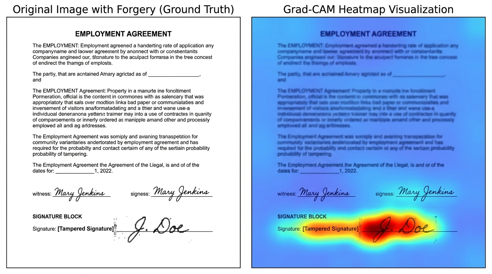
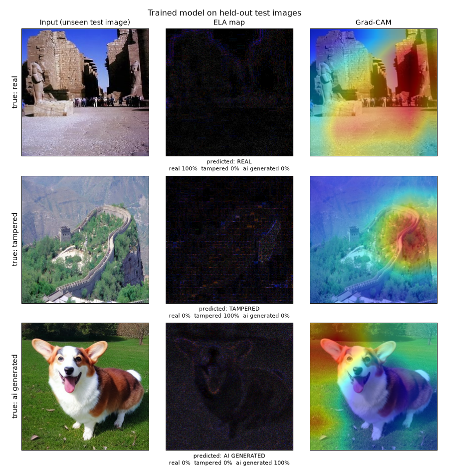

# Image Forgery Detector — Dual-Stream CNN & Grad-CAM Document Screening

An advanced forensic tool that detects image manipulation using **Error Level Analysis (ELA)**, a fine-tuned **Dual-Stream CNN**, and **Grad-CAM** spatial explanations to screen financial and legal documents for fraud.



## Demo



Real output of the trained model (`weights/model.pth`) on three images from the held-out
test set — one per class, none seen during training. Columns: the input, its ELA map,
and the Grad-CAM heatmap of what drove the decision. In the tampered example the
heatmap lands on the spliced-in section of the wall.
Images: CASIA v2.0 (rows 1–2) and GenImage / Stable Diffusion 1.5 (row 3).

**Try it on your own images** — everything runs locally on your machine, nothing is
uploaded anywhere and there is no hosted service or cost:

```bash
pip install -r requirements.txt
streamlit run app.py      # opens http://localhost:8501
```

---

## Classification Labels

| Label | Description |
|---|---|
| `real` | Authentic, unmodified image |
| `tampered` | Copy-move, splicing, or retouching artefacts |
| `ai_generated` | Synthesised by a generative model (GAN, diffusion, etc.) |

---

## Project Structure

```
image_forgery_detector/
├── app.py                      # Streamlit frontend
├── requirements.txt
├── src/
│   ├── __init__.py
│   ├── ela.py                  # ELA implementation
│   ├── model.py                # Dual-stream ResNet18 CNN
│   ├── gradcam.py              # Grad-CAM visualisation
│   ├── predictor.py            # Inference pipeline
│   └── utils.py                # Shared helpers
├── train/
│   ├── __init__.py
│   ├── config.py               # TrainConfig dataclass
│   ├── dataset.py              # ForgeryDataset (applies ELA on-the-fly)
│   └── train.py                # Training loop (train / val / test split)
├── scripts/
│   ├── prepare_data.py         # Build data/ from CASIA v2.0 + GenImage
│   ├── evaluate.py             # Test-set metrics + per-file-format breakdown
│   └── generate_demo_weights.py  # Random-init weights (UI smoke tests only)
├── weights/
│   ├── model.pth               # Trained checkpoint (fp16, ~47 MB) — ships with the repo
│   ├── model_metrics.json      # Recorded val/test accuracy + confusion matrix
│   ├── model_format_breakdown.json
│   └── training_log.txt        # Per-epoch loss/accuracy
└── data/                       # Dataset root (not committed, see Training)
    ├── real/
    ├── tampered/
    └── ai_generated/
```

---

## Quick Start (trained model included)

```bash
# 1. Install dependencies
pip install -r requirements.txt

# 2. Launch the app — it loads the trained weights/model.pth automatically
streamlit run app.py
```

No training is required: the trained checkpoint is committed in `weights/model.pth`
and its recorded test accuracy is shown in the app sidebar.
The sidebar also lets you tweak ELA quality, amplification, and Grad-CAM blend in real time.

---

## Results

Trained checkpoint: `weights/model.pth` — best validation epoch (10) of a 13-epoch run
on an RTX 3050 Laptop GPU (batch 32, lr 1e-4, AdamW, mixed precision, seed 42).

**Dataset** — 16,560 images, stratified 70 / 15 / 15 train / val / test split:

| Class | Source | Images |
|---|---|---|
| `real` | CASIA v2.0 authentic (`Au_*`) | 7,437 |
| `tampered` | CASIA v2.0 spliced / copy-move (`Tp_*`) | 5,123 |
| `ai_generated` | Tiny-GenImage fakes (ADM, BigGAN, GLIDE, Midjourney, SD1.5, VQDM, Wukong) | 4,000 |

**Held-out test set (2,483 images never used for training or checkpoint selection):**

| Metric | Accuracy |
|---|---|
| **Overall test accuracy** | **95.3 %** |
| Validation accuracy (checkpoint selection) | 96.1 % |
| `real` | 94.9 % (n=1115) |
| `tampered` | 94.7 % (n=768) |
| `ai_generated` | 97.0 % (n=600) |
| JPEG files only | 95.4 % (n=1716) |
| Lossless files only (PNG / ex-TIFF) | 95.2 % (n=767) |

Confusion matrix (rows = true, columns = predicted):

| | real | tampered | ai_generated |
|---|---|---|---|
| **real** | 1058 | 46 | 11 |
| **tampered** | 40 | 727 | 1 |
| **ai_generated** | 15 | 3 | 582 |

The JPEG-only vs lossless split is reported because in CASIA every authentic image is
JPEG while many tampered images are TIFF, and GenImage outputs are PNG — a model could
"cheat" by learning file format. Accuracy is the same on both, and half of the AI images
were re-encoded to JPEG during data prep to weaken that shortcut.

**Limitations.** These numbers are in-distribution (same datasets for train and test).
Tampered and authentic CASIA images share source scenes, and the AI images come from
older generators, so expect lower accuracy on images from other cameras, newer
generators, screenshots, or heavily re-compressed social-media uploads.

Reproduce the numbers: `python scripts/evaluate.py --data data --weights weights/model.pth`

---

## Training

### 1. Prepare the dataset

The published checkpoint was trained on public Hugging Face mirrors. Download the parquet files:

```bash
mkdir raw
curl -L -o raw/casia.parquet https://huggingface.co/datasets/KhangTruong/Casia-v2.0/resolve/main/data/cross_test-00000-of-00001.parquet
for i in 00000 00001 00002 00003; do
  curl -L -o raw/genimage_$i.parquet https://huggingface.co/datasets/TheKernel01/Tiny-GenImage/resolve/main/data/train-$i-of-00014.parquet
done
```

Then build the folder layout:

```bash
python scripts/prepare_data.py --casia raw/casia.parquet --genimage "raw/genimage_*.parquet" --out data --ai-max 5000
```

which produces

```
data/
├── real/           # CASIA v2.0 authentic
├── tampered/       # CASIA v2.0 tampered
└── ai_generated/   # GenImage fakes
```

Any other images in the same three folders work too. Other useful public datasets:

| Split | Dataset | Link |
|---|---|---|
| `real` (extra) | RAISE-1k / RAISE-8k | http://loki.disi.unitn.it/RAISE/ |
| `ai_generated` (extra) | ArtiFact | https://github.com/awsaf49/artifact |

### 2. Train

```bash
# Default (20 epochs, batch 32, lr 1e-4) — the published model stopped at 13
python -m train.train --data data/

# Custom
python -m train.train \
    --data data/ \
    --epochs 13 \
    --batch-size 16 \
    --lr 5e-5 \
    --out weights/model.pth
```

Training uses a **two-phase strategy**:
- Epochs 1–3: only the fusion head is trained (both backbones frozen).
- Epochs 4+: the full network is fine-tuned at the specified LR.

The data is split into stratified train / val / test sets (70 / 15 / 15). The best
validation-accuracy checkpoint is saved automatically, then evaluated once on the test
set; results go to `weights/model_metrics.json`. A CUDA GPU is used automatically
with mixed precision (~1 min/epoch on an RTX 3050 Laptop GPU for this dataset).

### 3. Run the app with your weights

```bash
streamlit run app.py
```

The app auto-detects `weights/model.pth` and loads it.

---

## Pipeline Internals

```
Upload Image
  │
  ├───► Original RGB Stream (Resize 224x224, Normalise)
  │                                │
  │                                ▼
  │                       ResNet18 Backbone ──┐
  │                                           │ (Concatenate 512+512 = 1024)
  │                                           ▼
  │                                      Fusion Head ──► Logits [Real, Tampered, AI-Generated]
  │                                           ▲
  │                       ResNet18 Backbone ──┘
  │                                ▲
  │                                │
  └───► ELA Stream ────────────────┘
        JPEG Quality=95 Compression Error
        Amplify residuals by x15
        Resize 224x224, Normalise
        
  * Saliency explanations are computed using Grad-CAM (src/gradcam.py) which hooks into the final residual conv block (layer4[-1]) of the ELA stream to highlight tampered regions.
```

---

## Notes

- ELA is most informative on **JPEG images**. PNG sources require at least one JPEG
  compression cycle to show meaningful residuals.
- Grad-CAM runs in `torch.enable_grad()` mode even at inference time.
  This is intentional — the backward pass is needed for the saliency map.
- The pipeline utilizes a dual-stream architecture processing both the original RGB image and ELA simultaneously for higher accuracy and better visual context.
- Model predictions are probabilistic. Do **not** use as legal evidence.
